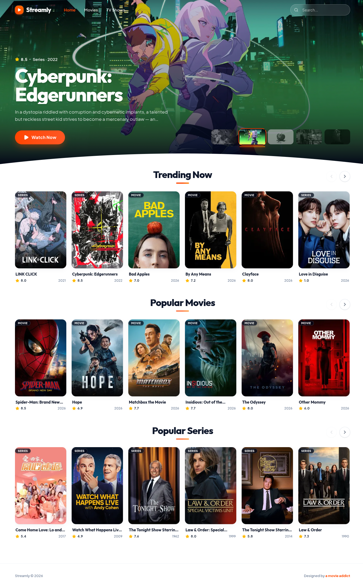
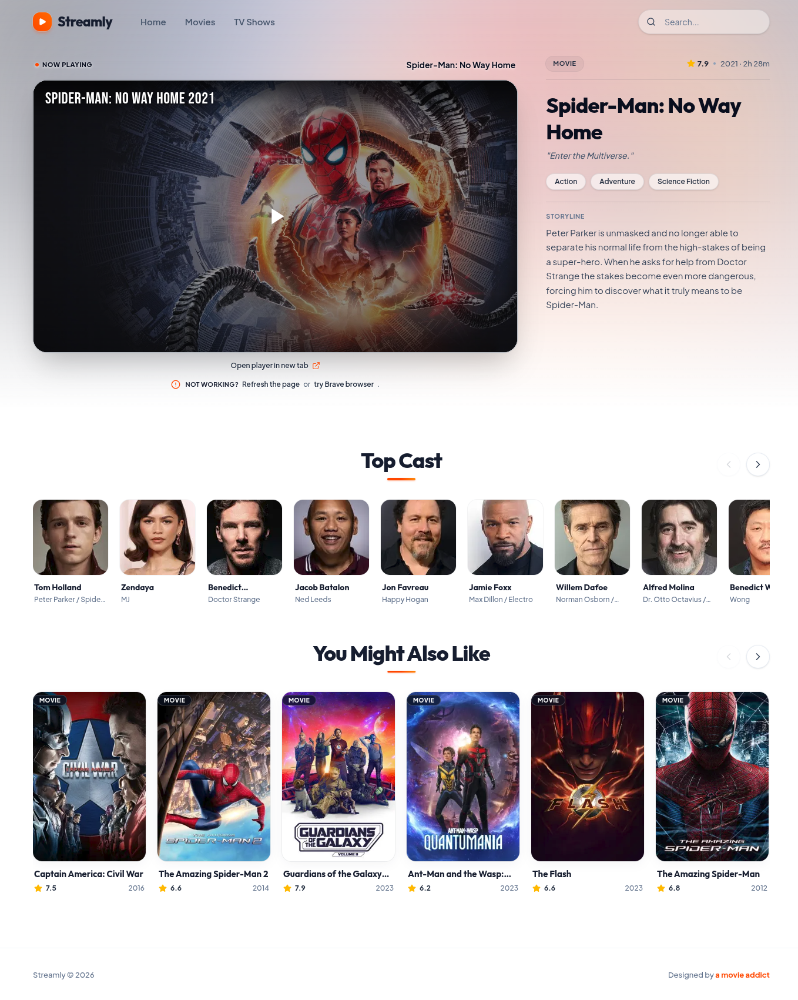
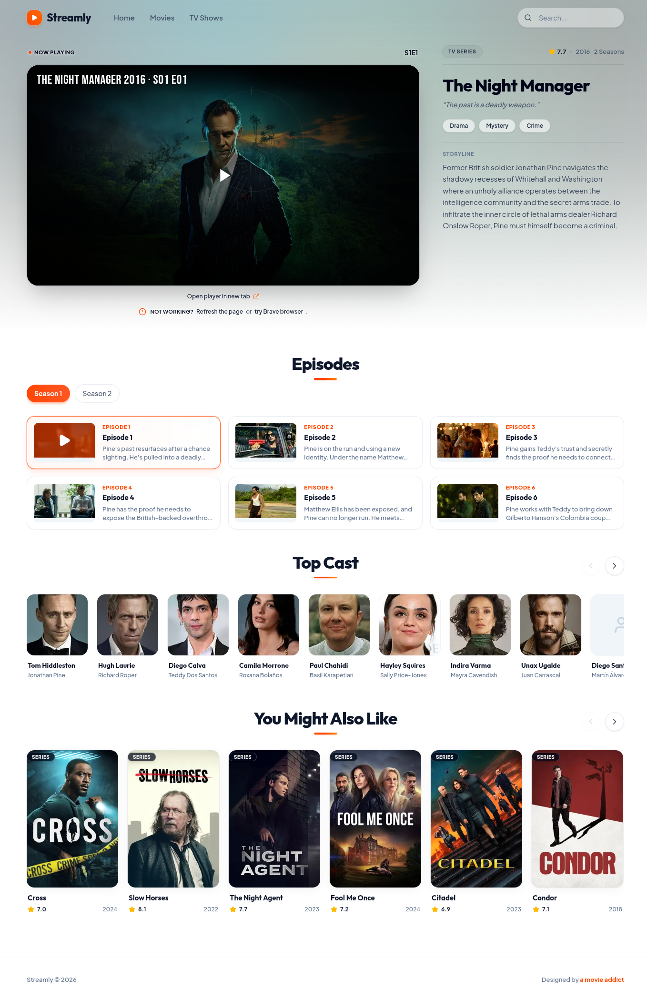

# Streamly

A Movies & Series streaming website built with Next.js , IMDB api , OMDB API and VIDSRC API, 

## Home Page


## Movies Page

 


## Series Page



## Installation

1. Clone the repository:
   ```bash
   git clone https://github.com/localhost969/Streamly.git
   cd Streamly
   ```

2. Install dependencies:
   ```bash
   npm install
   ```

3. Set up environment variables:
   Open`.env` file in the root directory and add your OMDB API key:
   ```
   NEXT_PUBLIC_OMDB_API_KEY=your_omdb_api_key_here
   ```

4. Run the development server:
   ```bash
   npm run dev
   ```

